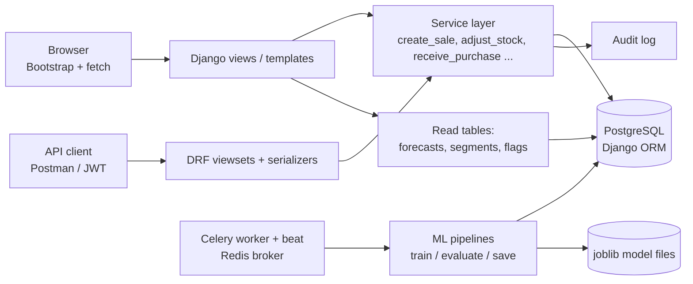
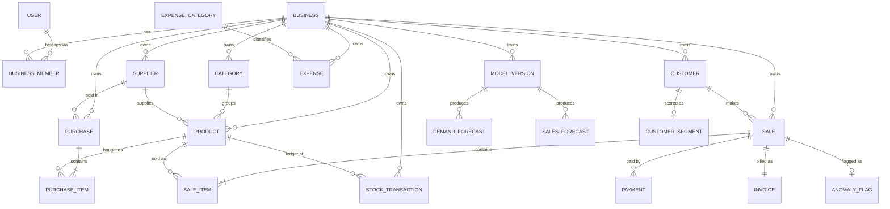

# Architecture

## 1. Style: modular monolith
One Django project, one PostgreSQL database, server-rendered pages (Bootstrap + a little JavaScript) and a REST API
(DRF) that calls the **same service functions** as the web pages. No microservices: the data model is strongly
relational (a sale touches stock, payments, invoices and audit in one transaction) and a monolith keeps that
transaction local and simple.

## 2. Apps and responsibilities
| App | Owns |
|---|---|
| `accounts` | custom `User`, login (with lockout), registration |
| `businesses` | `Business` (tenant), `BusinessMember` (role per business), tenant middleware, permission map, invoice counters |
| `catalog` | `Category`, `Supplier`, `Product` |
| `inventory` | `StockTransaction` (ledger), `Purchase`/`PurchaseItem`, `adjust_stock()` |
| `customers` | `Customer`, balances (computed), customer payments |
| `sales` | `Sale`, `SaleItem`, `Payment`, `Invoice`, `create_sale()`, PDF invoices |
| `finance` | `Expense`, `ExpenseCategory`, receipt validation |
| `analytics` | KPIs, profit, rule-based insights, reports (+CSV) |
| `ml` | forecasting, segmentation, anomaly detection, associations, model versions |
| `notifications` | in-app alerts (low stock, forecast shortage, overdue payments) |
| `audit` | append-only `AuditLog` |
| `api` | DRF routers, serializers, permissions, error format, JWT |
| `core` | base models (`TenantModel`), generic list/form views, helpers, demo-data command |

Rule: **views are thin, services do the work**. Anything that changes money or stock lives in `services.py`.

## 3. Database design (ER diagram)

### Key decisions (and why)
| Decision | Reason |
|---|---|
| **Role is on `BusinessMember`, not `User`** | One person may work for several businesses with different roles. |
| **Stock ledger is the source of truth**; `Product.current_stock` is a cache updated in the same transaction | Complete history for analytics/ML; `reconcile_stock` command proves the cache never drifted. |
| **Snapshot prices on `SaleItem`** (`unit_price`, `cost_price`, `product_name`) | Editing a product later must never rewrite past sales or profit. |
| **`DecimalField` for all money** | Floats cannot represent rupees/paise exactly. |
| **Soft delete** (`is_active`) and `on_delete=PROTECT` on history | A product with sales can never be hard-deleted. |
| **Customer spend/outstanding are computed**, not stored | They can never disagree with the sales table. (`Sale.amount_paid` is a cached sum of `Payment` rows, updated only in services.) |
| **Per-business invoice sequence** (`BusinessSequence` + `select_for_update`) with `UNIQUE(business, number)` | `max()+1` races under concurrency. Tested with real concurrent threads. |
| **CHECK constraints** (stock ≥ 0, qty > 0, paid ≤ total ...) | The database protects invariants even if application code has a bug. |
| **Composite indexes** `(business, -sale_date)`, `(business, product, -occurred_at)` | These match the hottest queries (dashboards, ledger, ML data loads). |
| **Prediction tables** (`DemandForecast`, `SalesForecast` ...) | Dashboards read stored predictions; they never train a model on page load. |

## 4. Multi-tenancy: how isolation is enforced
1. Every business-owned model inherits `core.models.TenantModel` (a mandatory `business` foreign key and a manager with `.for_business()`).
2. **The business is derived from the logged-in user's memberships** (`businesses.tenancy.resolve_membership`) in middleware (web) or per request (API). It is never read from a URL, form field or JSON body that identifies a record. A forged session value or `X-Business-ID` header only works if the user really belongs to that business.
3. Generic list/form views get their queryset from `for_business(request.business)`; detail pages use `get_object_or_404(Model.objects.for_business(...), pk=...)`, so another tenant's ID returns **404** (not 403), which does not even reveal the object exists.
4. Child rows (`SaleItem`, `PurchaseItem`) are only reached through their tenant-scoped parent.
5. **Forms and serializers are locked to the tenant too**: `TenantModelForm` and `BusinessPKField` restrict every dropdown/foreign-key to the current business, so a forged POST containing another tenant's category/product/customer ID fails validation.
6. Unique constraints include the business (`UNIQUE(business, sku)`): two shops may both have SKU `PEN-01`.
7. Service functions re-check ownership (`Product.objects.get(pk=..., business=business)`), so even a coding mistake in a view cannot sell another shop's product.
8. Tests (`businesses/tests/test_security.py`, `api/tests/test_api.py::APITenantIsolationTests`) attack all of this: foreign IDs on every detail/edit/delete/receipt/invoice URL, foreign IDs inside POST bodies, forged session, forged header.

## 5. Authentication and authorization
* Web: Django sessions, CSRF protection on every POST (also on the JSON sale/purchase endpoints), password hashing (PBKDF2), login lockout (5 failures / 15 min per IP + username).
* API: JWT (`/api/v1/auth/token/`, 30-minute access token, 7-day refresh), login endpoint throttled 10/min, global throttles.
* Authorization: `businesses/permissions.py` maps **role → permission strings** in one file. Views declare `required_permission`; API views declare `perm_view`/`perm_manage`/`perm_by_action`. Employees never receive cost prices or profit data (hidden in templates **and** the API serializer).

| Capability | Owner | Manager | Employee |
|---|:-:|:-:|:-:|
| Create sales, search products, view customers | ✔ | ✔ | ✔ |
| Manage products, customers, suppliers, stock, purchases; cancel sales | ✔ | ✔ | ✖ |
| Sales dashboard, non-financial reports, AI insights | ✔ | ✔ | ✖ |
| Profit, expenses, inventory value, financial reports | ✔ | ✖ | ✖ |
| Team, business settings, audit log, retrain models | ✔ | ✖ | ✖ |

## 6. The sale transaction
`sales.services.create_sale()` runs inside `transaction.atomic()`:
validate items → lock each product row (`select_for_update`, fixed id order) → write `Sale` → `SaleItem` (price snapshots) → `adjust_stock()` (ledger row + cached stock, refuses < 0) → `Payment` → `Invoice` (locked sequence) → `AuditLog`. Any error rolls **everything** back; there is a test that proves a failed sale leaves no partial data.

## 7. Background jobs
`config/celery.py` + `ml/tasks.py` + `notifications/tasks.py`. Beat schedule: alerts hourly, model retraining weekly. Celery is optional: the same work is available as `manage.py train_models` and `manage.py generate_alerts`, and from the "Retrain models now" button.

## 8. File uploads
Receipts: extension allow-list (PDF/PNG/JPG), 2 MB limit, **magic-number check** (content must match the extension), random server-side filename, stored outside any public URL and streamed only through an authorised, tenant-scoped view.
