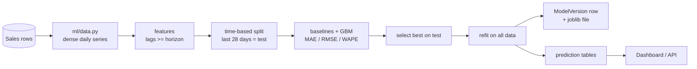

# ML and analytics methodology

> **Data honesty.** Real shop data was not available, so the demo business is **synthetic**
> (`python manage.py seed_demo_data`). It is generated with weekday effects, school/festival seasons, intermittent
> demand, bundles bought together, credit customers and 5 injected outliers. All figures below come from that
> synthetic data and say how the *pipeline* behaves; they are **not** claims about real-world accuracy.
> The numbers on your machine will differ slightly (the simulation is anchored to today's date).

## Pipeline (nothing trains when a page opens)

Run it with `python manage.py train_models --all`, the *Retrain models now* button (owner), or the weekly Celery beat task.
Every run creates a new `ModelVersion` (version number, algorithm, data window, metrics, artifact path); older versions are kept but marked inactive.

## 1. Demand forecasting (per product, next 7 days)
* **Data**: units sold per product per day, from the product's first sale to yesterday (zeros included).
* **Direct multi-horizon design**: every feature is at least 7 days old (`lag_7`, `lag_14`, `lag_21`, rolling 7- and 28-day means of the series shifted by 7, day-of-week, day-of-month, month, product mean, product×weekday mean). Predicting day t+1 … t+7 therefore never needs a recursive guess and never sees the future.
* **Leakage control**: the split is by time (last 28 days = test). Product means are computed from the training period only. A unit test changes "future" values and proves today's features do not move.
* **Candidates**: `seasonal_naive` (same weekday last week), `mean_28d`, `group_mean`, `dow_mean` (baselines) vs `gradient_boosting` (scikit-learn, one global model across products).
* **Metrics**: MAE, RMSE, WAPE. **MAPE is deliberately not used**: daily demand has many zeros. Because the shop acts on the *7-day total* (what to order), models are also scored on non-overlapping 7-day blocks (`block_mae`, `block_wape`) and **selected by that metric**.
* **Ineligible products** (too little history / too few sale days) are shown as "Not enough history" instead of getting a fake number.
* **Action**: `predicted 7-day demand > stock` → "Potential shortage" with a suggested order quantity (`demand + minimum stock − stock`) and a notification.

Example run on the synthetic data (34 products, 952 held-out product-days):

| Method | 7-day total MAE (units) | 7-day total WAPE | Daily MAE |
|---|---|---|---|
| **mean_28d (selected)** | **4.62** | **0.56** | 1.35 |
| dow_mean | 4.68 | 0.57 | 1.38 |
| group_mean | 4.69 | 0.57 | 1.39 |
| gradient_boosting | 4.74 | 0.57 | 1.40 |
| seasonal_naive | 6.18 | 0.75 | 1.53 |

**Honest reading:** on this data the learned model did **not** beat a simple 28-day average, so the system selected the baseline. That is the correct behaviour (and a realistic outcome: demand of slow products in a small shop is dominated by random noise). A 7-day-total WAPE of ~0.56 means forecasts for individual products are rough; they are a planning aid, not a promise. The synthetic data has weekday and seasonal structure, so on data with stronger signal (or more history) the gradient-boosting model can win; the selection logic will pick it automatically (a unit test checks that it beats the global mean on a strongly weekly series).

## 2. Business sales forecast (next 14 days)
Same engine with one series (daily revenue) and horizon 14 (features ≥ 14 days old). The shaded range on the chart is the forecast plus the **10th/90th percentile of the model's own held-out errors**: an empirical range, explicitly *not* a "95% confidence" claim. On the synthetic run the best method was `dow_mean` (daily MAE ≈ 855, WAPE ≈ 0.39); gradient boosting did poorly (WAPE ≈ 1.6) because a single series with ~180 training days is too little data, again reported rather than hidden.

## 3. Customer segmentation (RFM + K-Means)
* **RFM**: Recency (days since last purchase), Frequency (completed sales), Monetary (total spent). Each is scored 1–5 by quantile rank (recency inverted so that recent = high).
* **Segments** from transparent rules: *Inactive* (> 90 days) · *At Risk* (low recency score but ≥ 3 orders) · *High Value* (M ≥ 4, F ≥ 3, R ≥ 3) · *Loyal* (F ≥ 4, R ≥ 3) · *Regular* · *Occasional*.
* **K-Means as a data-driven check**: features are `log1p`-transformed (spend is heavily skewed) and standardised (otherwise rupees would dominate the distance); k is chosen from 2…6 by the best **silhouette score**. Clusters are **not given invented names**; the UI shows each cluster's real average recency/frequency/spend so a human can interpret it. On the demo data k = 3 with silhouette ≈ 0.29, i.e. weak structure, which is shown, not hidden.
* Needs ≥ 10 customers with purchases.

## 4. Anomaly detection ("potentially unusual transactions")
* **Isolation Forest** (unsupervised) over: bill total, distinct items, total quantity, hour of day, largest quantity relative to that product's median, discount share.
* There are **no fraud labels**, so there is no "accuracy". Output is a ranked review list labelled *Potentially unusual transaction*, with plain-language reasons from a robust (median/MAD) z-score, e.g. "one item quantity is 24.0x that product's usual quantity".
* Sanity check on demo data: all 5 clearly-labelled injected outliers were flagged, along with ~2% of sales (the configured `contamination`), most of which are ordinary bulk orders. That is why a human marks them reviewed.
* Needs ≥ 100 sales.

## 5. "Frequently bought together"
Plain co-occurrence statistics over sales baskets: `support`, `confidence(A→B)`, `lift`. Rules need ≥ 3 co-occurrences and lift ≥ 1.2. Shown on the product page and as one-click suggestions on the new-sale screen. Needs ≥ 30 sales.

## 6. Rule-based insights (no ML, fully explainable)
Sales growth/decline over the last 4 weeks vs the 4 before, products with three consecutive weekly declines, days of stock left at the recent selling rate, slow-moving stock (value tied up), inactive customers, outstanding balances. Every sentence is built from queries; nothing is invented, and an empty business shows no insights.

## 7. Profit definitions
* *Gross profit* = Σ (unit_price × qty − discount − cost_price × qty) over **completed** sales, using the **snapshot** prices stored on each sale item (tax excluded).
* *Estimated net profit* = gross profit − expenses in the same period.
* Purchases are **not** expenses; stock is an asset until sold.

## 8. Retraining strategy and monitoring
* Weekly Celery beat task (or on demand). New `ModelVersion` each time; the dashboard reads the active version.
* Demand forecasts store `predicted_demand` and `current_stock` per version, so predictions can later be compared with realised sales (a natural next step: a forecast-vs-actual monitoring page).
* Known limitations: no promotions/price effects, no stock-outs correction (a zero may mean "sold out", not "no demand"), new products have no history, one global model per business, synthetic validation only.
